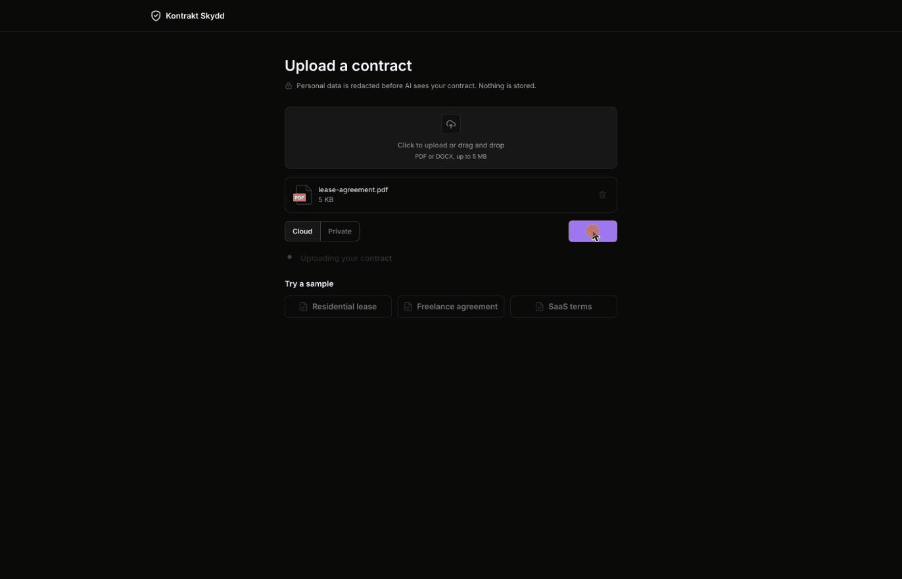
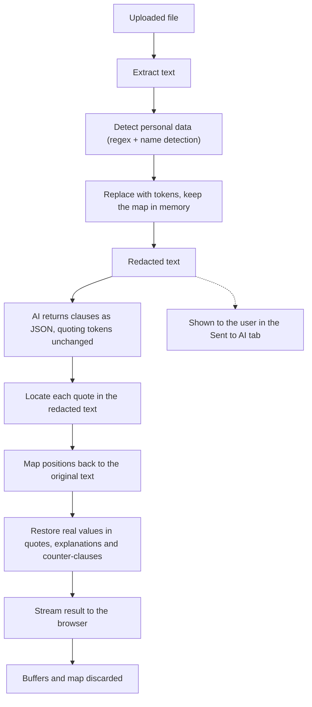
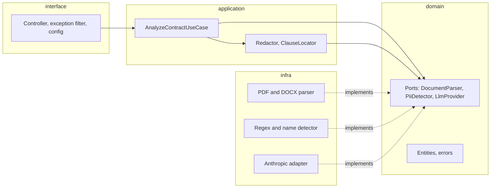

# Kontrakt Skydd

Upload a contract (PDF or DOCX) and get its risky clauses highlighted, each with a plain-English explanation and a suggested counter-clause. Personal data is redacted before any text reaches the AI, and nothing is stored.

Live demo: https://kontrakt-skydd.vercel.app. Not legal advice, see [Known limits](#known-limits).



## How it works

1. Upload a PDF or DOCX, or open one of three sample contracts.
2. The server extracts the text and redacts personal data.
3. The redacted text goes to the AI, which returns the risky clauses as JSON: category, risk level, explanation and counter-clause.
4. The server puts the real values back and streams the result to the browser. Nothing is saved.
5. The contract appears with highlighted clauses (red high, amber medium, grey low) and a side panel with the details. An Original tab shows the real PDF pages with the same highlights on top (PDFs only), and another tab shows exactly what was sent to the AI.

Risk is never shown by colour alone: each level also has its own underline (solid, dashed or dotted).

## What I built and learned

- **PII redaction:** replacing personal data with tokens before the AI sees it, then restoring the real values.
- **Schema validation:** checking the AI's JSON with Zod, retrying once, and locating each quote in the source text.
- **Clean architecture (ports and adapters):** NestJS use cases depend on interfaces, so the AI provider can be swapped by writing one adapter.
- **Server-sent events:** streaming progress and results over a POST with `fetch`, and cancelling the AI call when the user leaves.
- **URL as state:** TanStack Router keeps the risk and category filters in typed search params, so a view can be shared.
- **Accessibility:** keyboard navigation, ARIA labels, and risk shown with underline styles as well as colour.
- **Performance:** code splitting, lazy loading and memoization, which cut first-load JavaScript by about 11%.
- **Deployment and hardening:** Docker on Render, a static build on Vercel, rate limits, and a Content-Security-Policy.

## Privacy model

Privacy is the main feature, so these rules are enforced in code:

- Files and extracted text are never written to disk or a database. Uploads are held in memory for the length of the request.
- The AI only sees the redacted text. Names, emails, phone numbers, personal numbers, IBANs, postcodes, street addresses, company names with a legal suffix and money amounts are replaced with tokens such as `[PERSON_1]`.
- The token map exists only in request memory. It is never returned, cached or logged.
- Logs hold request ids, file sizes, timings, token counts and error codes. They never hold document text, redacted or not.
- Error messages sent to the browser never contain document text.
- The browser keeps the result, and the uploaded PDF for the Original tab, in memory only. The PDF is rendered in your browser and is never sent anywhere except the analysis request. Refreshing the results page clears both. Nothing goes in `localStorage` or `sessionStorage`.
- The web app makes no third-party requests: fonts are self-hosted and there are no analytics or CDN links.
- CORS allows only the web app's origin.
- The sample contracts contain made-up data only.

The redacted text still goes to a third-party AI provider (Anthropic), and redaction is best-effort. The "Sent to AI" tab shows exactly what left your machine; read [Known limits](#known-limits) before uploading anything sensitive.

## Redaction pipeline



Detection uses regular expressions for emails, phone numbers, Swedish personal numbers, IBANs, postcodes, street addresses, company suffixes and amounts, plus the `compromise` library for person names. Cities are left alone so jurisdiction clauses stay readable.

## Architecture

The API follows clean architecture. Dependencies point inward, and the domain layer imports no libraries.



Use cases depend on ports and never on concrete adapters. The adapters are bound to the ports in `apps/api/src/app.module.ts`, so swapping the AI provider means writing one adapter.

```
apps/
  web/                 TanStack Start (SPA mode), TanStack Router and Query, Untitled UI, Tailwind, pdf.js
  api/                 NestJS
packages/
  shared/              Zod schemas and types used by both apps
  eslint-config/       shared lint config
  typescript-config/   shared tsconfig
```

### API

`POST /api/v1/analyses` takes `multipart/form-data` with `file` and `mode`, and answers with a server-sent event stream:

```ts
{ type: "progress", step: "parsing" | "redacting" | "analyzing" }
{ type: "result", data: ContractAnalysis }
{ type: "error", code: string, message: string }
```

The browser reads the stream with `fetch`, because `EventSource` cannot send a POST. Errors found before the stream starts come back as plain JSON `{ code, message }` with an HTTP status. `GET /api/v1/health` is used by the host's health check and is exempt from rate limits.

Every shape that crosses the network is defined once in `packages/shared` as a Zod schema and validated at each edge: the upload, the environment variables, the AI's output and the events in the browser.

### Why TanStack Start

The web app needs file-based routes, typed search params and a data layer, and TanStack Router and Query cover all three. The results page keeps its filters in the URL (`risk`, `category`, `clause`), so a filtered view can be shared or reloaded. Start runs in SPA mode and ships static files with no server functions, because the NestJS API is the only backend.

## Run it locally

You need Node 24 and pnpm 11.

```bash
pnpm install
cp apps/api/.env.example apps/api/.env
cp apps/web/.env.example apps/web/.env
```

Put an Anthropic API key in `apps/api/.env` as `ANTHROPIC_API_KEY`, then:

```bash
pnpm dev
```

The web app is on http://localhost:3000 and the API on http://localhost:3001. The sample contracts work without a key because their results are precomputed.

Other commands: `pnpm build`, `pnpm lint`, `pnpm check-types`, `pnpm test`.

### API environment variables

| Variable                     | Default  | Purpose                                                                       |
| ---------------------------- | -------- | ----------------------------------------------------------------------------- |
| `PORT`                       | `3001`   | Port to listen on                                                             |
| `WEB_ORIGIN`                 | required | The only origin CORS allows                                                   |
| `LLM_PROVIDER`               | required | Only `anthropic` has an adapter                                               |
| `LLM_MODEL`                  | required | Model id, for example `claude-sonnet-5-5`                                     |
| `ANTHROPIC_API_KEY`          | required | Key for the provider                                                          |
| `TRUST_PROXY_HOPS`           | `0`      | Proxies in front of the API, so the per-IP limit sees the real client address |
| `RATE_LIMIT_PER_IP_PER_HOUR` | `3`      | Analyses per IP per hour                                                      |
| `RATE_LIMIT_PER_DAY`         | `50`     | Analyses per day across all visitors                                          |
| `MAX_DOCUMENT_CHARACTERS`    | `60000`  | Longest extracted text accepted                                               |

The web app reads `VITE_API_URL` at build time (default `http://localhost:3001`).

## Samples

`apps/web/public/samples/` holds three made-up contracts (lease, freelance agreement, SaaS terms), each as a PDF and a DOCX with a precomputed `.result.json`. Opening a sample loads that JSON and never calls the API, so the public demo costs nothing to browse. Regenerate the JSON files when the prompt, the model or the redactor changes.

## Deployment

- **API:** a Docker image built from the root `Dockerfile`, deployed to Render with the `render.yaml` Blueprint. Set `ANTHROPIC_API_KEY` and `WEB_ORIGIN` in the dashboard.
- **Web:** a static build on Vercel with `apps/web` as the root directory. Set `VITE_API_URL` to the API's URL. `apps/web/vercel.json` handles routing, security headers and a Content-Security-Policy that allows connections only to the site and the API origin (update that origin if the API moves).

The public demo allows 3 analyses per IP per hour, 50 per day overall and 60,000 characters per document.

## Known limits

- **Not legal advice.** The output is an AI's opinion. It can miss risky clauses, flag harmless ones and suggest counter-clauses that do not fit your situation. Have a lawyer review anything that matters.
- **Name detection can miss names.** It is tuned for English, so names it does not recognise (for example "Örjan Öberg") reach the AI unredacted. Check the "Sent to AI" tab.
- **Some details are not redacted.** Apartment and unit numbers ("apartment 1204") are kept, only the street address is replaced. ISO dates are kept. Cities are kept on purpose.
- **Text that already looks like a token** (for example `[PERSON_1]` written in the contract) would be restored wrongly.
- **Private mode is not built.** The cloud/private toggle is shown but private is disabled, and the API rejects it. A local-model adapter would be needed.
- **Original view is PDF only.** DOCX files show the text view only. Highlights on the PDF are placed by matching each quote against the page text, so a finding that cannot be matched has no highlight on the page, and the text on the page cannot be selected. There is no OCR, so scanned documents without a text layer do not work.
- **English only,** PDF and DOCX up to 5 MB.
- **Clause positions can be approximate.** If a quoted clause cannot be found exactly, a close match is used.
- **Cost controls are best-effort.** Rate limits are in memory on one instance, so a restart resets them. Set a spend limit on the AI provider account as the final backstop.

## Not built

Accounts, a database, an Ollama adapter for private mode, Swedish contracts, and comparing two versions of a contract.
